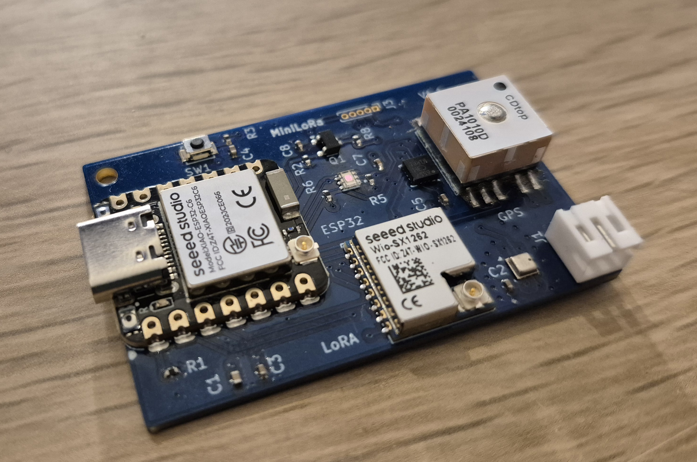
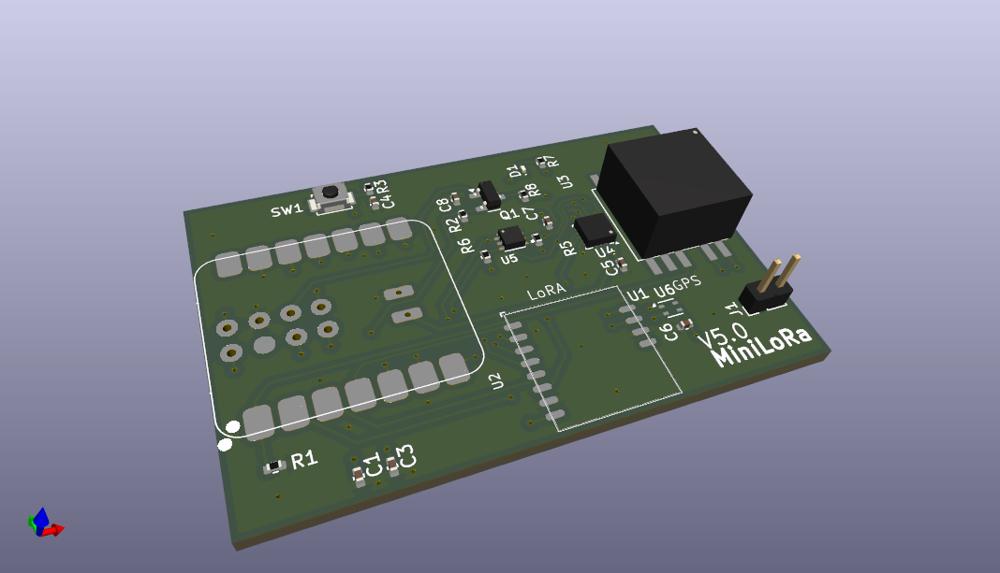
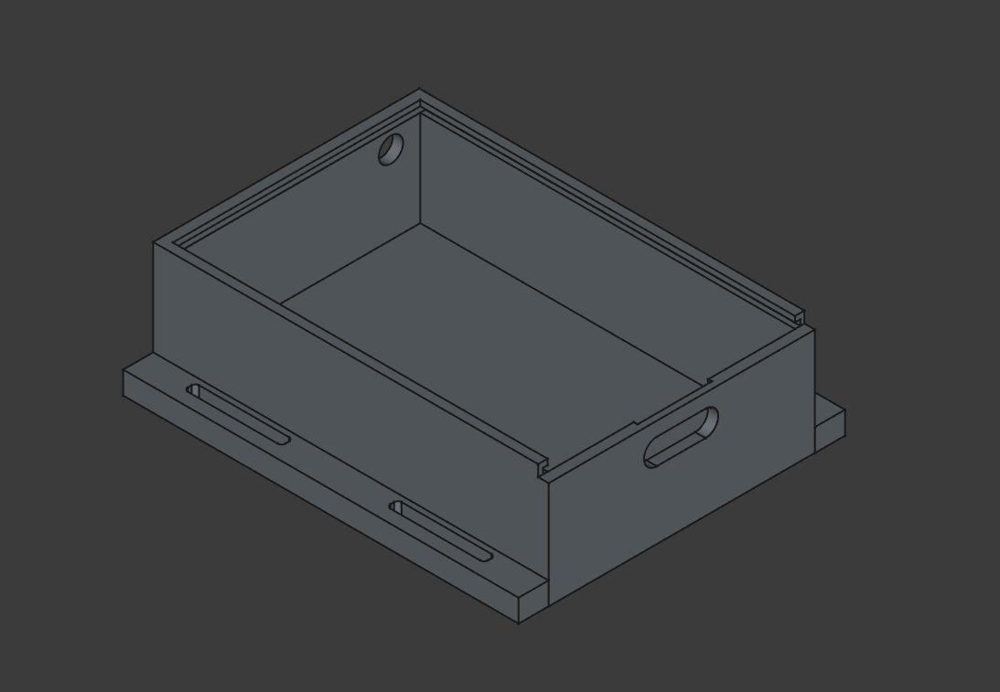

# Introduction

---
<!---
Discord server dedicated to this project :

---
-->
## Table of Contents

- [✨ What's MiniLoRa?](#-whats-minilora)
- [⚙️ Hardware Overview](#️-hardware-overview)
- [💾 Software Overview](#-software-overview)
- [🚀 Planning & next steps](#-planning--next-steps)
- [📷 Screenshots](#-screenshots)

## 🏁 Getting started

**Bring up a blank tracker out of the box: [HowToStart.md](HowToStart.md)**
— register it in TTN, provision it over BLE from the Android app, and see
the first readings on your server. The full manual lives in
[`SW/Current/docs/`](SW/Current/docs/README.md).

## ✨ What's MiniLoRa?

Small size multi-purpose **ESP32-C6** board with **LoRa** and **2.4 GHz** connectivity.

**Main focus**

* Low power consumption for long battery life
* Multiple wireless connectivity
* Sensors packed
* Small size

### Features

* ESP32-C6 module -> <a href="./DOC/Datasheets/ESP32-C6-MINI-1.pdf">ESP32-C6-MINI-1 (module)</a> · <a href="./DOC/Datasheets/esp32-c6.pdf">esp32-c6 (chip)</a>
  * 32 bits RISC-V Main processor : 160 MHz
  * 32 bits RISC-V Low power processor : 20 MHz
  * 512 KB RAM
  * 4 MB FLASH
  * RTC
  * Wi-Fi 6 (2.4 GHz)
  * Bluetooth 5 (BLE)
  * Zigbee / Matter / Thread (802.15.4)
  * All 2.4 GHz radios : Internal or external antenna switch via GPIO
* LoRa modem -> <a href="./DOC/Datasheets/Wio-SX1262_Module.pdf">WIO-SX1262</a>
  * LoRaWan capable
  * External Antenna
* GNSS with integrated antenna and PPS -> <a href="./DOC/Datasheets/CD-PA1010D.pdf">CD-PA1010D</a>
* Temperature, humidity and pressure sensor -> <a href="./DOC/Datasheets/bst-bme280-ds002.pdf">BME280</a>
* Luminosity sensor -> <a href="./DOC/Datasheets/opt3001.pdf">OPT3001</a>
* 3-axis accelerometer with wake-on-motion -> <a href="./DOC/Datasheets/lis3dh.pdf">LIS3DH</a>
* Ultra-low-power 3.3 V rail -> <a href="./DOC/Datasheets/SGM6029.pdf">SGM6029</a> (2.3 µA Iq buck)
* USB + solar Li-ion charging -> <a href="./DOC/Datasheets/CN3165.pdf">CN3163 / CN3165</a>
* External connector with : Power, I2C and 1 GPIO
* 1 user accessible LED
* 1 user accessible button
* Voltage reading of the battery
* Integrated BMS and JST connector

## ⚙️ Hardware Overview

**PCB dimension**

| D| mm|
| --- | --- |
| L | 50 |
| W | 32 |
| H | 12,5* |

* including GNSS module and JST connector

**PCB Info**

Design with Kicad 9.0

* Full schematic and design can be found under **HW** (`MiniLora.kicad_sch` / `.kicad_pcb`)
* Production files for the current batch are under **HW/Gerber**, **HW/JLCPCB** and **HW/production**
* Datasheet index for every part: **[DOC/README.md](DOC/README.md)**
* PDF can be found under : **DOC/Schematics**
* The decision log for the next hardware revision: **[HW/Next_HW_version.md](HW/Next_HW_version.md)**
* Superseded hardware (OLD-BETA5): kept in the local repository only — not published.

**Enclosure Info**

Design with FreeCad 1.0

* Very basic and not finished
* Can be 3D printed with basic HW
* Should be improved in the future
* Thought to be attached to backpack

## 💾 Software Overview

**📖 Documentation (v2 firmware & app): [`SW/Current/docs/README.md`](SW/Current/docs/README.md)**
— user guide (Android app), flashing & OTA, firmware architecture,
LoRaWAN uplink/downlink reference, Zigbee/Home-Assistant integration.
The byte-level wire contract lives in [`SW/Current/ICD.md`](SW/Current/ICD.md).

**Firmware (ESP-IDF, v2.6.x)** — remote configuration over LoRa downlink
(transports, sensors, sleep duration), OTA updates with WiFi force+restore,
wake-on-motion asset mode, store-and-forward buffer, bounded logs.

**Server (FastAPI + SQLite)** — WiFi push + TTN poller ingestion, graphed
web UI (per-page routes, grouped devices, range selectors), remote
commands, OTA firmware hosting, HA bridge via MQTT discovery, and
LAN-ready deployment: Docker (bounded logs, 100 MB-capped database with
`/api/retention`) or a [Proxmox LXC](SW/Current/MiniLoRa-server/deploy/proxmox-lxc.sh).

I2C adresses of sensors

| Sensor| ADD|
| --- | --- |
| GNSS | 0x10 |
| ACC | 0x18 |
| TEMP | 0x76 |
| LUM | 0x47 |

GPIO Mapping

The authoritative pin map is the firmware header
[`SW/Current/Firmware/main/drivers/Pins.hpp`](SW/Current/Firmware/main/drivers/Pins.hpp) —
kept in sync with the schematic (the I2C addresses below match it). It also
documents which pins are RTC/LP-capable (the deep-sleep wake sources:
button, accelerometer interrupt, GPS PPS on the shared `PPS_INT` net) and
which enables are held through sleep. The next board's pin plan lives in
the [hardware planning doc](HW/Next_HW_version.md) (§6).

External Connector Mapping

1 is defined as the squared one, closest to J3 marking 

| Pin | Usage|
| --- | --- |
| 1 | GND |
| 2 | SCL |
| 3 | SDA |
| 4 | VCC |
| 5 | GPIO6 |

## 🚀 Planning & next steps

The roadmaps are **living documents** — [HW/Next_HW_version.md](HW/Next_HW_version.md),
[SW/Current/docs/Next-Improv.md](SW/Current/docs/Next-Improv.md) and
[SW/Current/docs/Next-AP-Initial.md](SW/Current/docs/Next-AP-Initial.md) —
each with its own decision log. The distilled state:

**Already done** (struck from every wishlist): remote config over LoRa
downlink, OTA with WiFi force+restore, wake-on-motion asset mode (all in
fw 2.6.16), bounded logs + 100 MB-capped database, Docker + Proxmox LXC
deployment, the self-made ESP32-C6-MINI-1 board, the CN3165 solar
charger, repo reorganization and the public release.

**Next moves — hardware** (gated by the §5 prototype-first rule):

1. **Bench session on a Wio-S3 dev board**: firmware port + deep-sleep
   current measurement — the go/no-go for the next PCB (§1.4, §1.6).
2. **LIS3DH wake→read timing check** (the constant-133 question) —
   load-bearing for asset mode (§5.3).
3. **Asset-mode field test**: shake test, `wake=motion` burst cycle,
   battery slope before/after (§5.3).
4. **Wio-S3 datasheet answers**: 2.4 GHz antenna routing + which RTC
   pins the 38-pin header exposes — finalizes the §6 pin plan.

**Next moves — server** (no hardware needed, any order):

1. ~~**Delivery ratio from TTN `f_cnt`**~~ **done** — stored per uplink,
   delivery card per identity on the Analytics page.
2. ~~**Battery projection + missed-cycle detection**~~ **done** — days-to-critical
   projection + missed-uplink count, both on the Analytics page with a ⚠
   warning strip (`/api/analytics` `link`/`battery`/`cycles`/`warnings`).
3. **Energy audit** — measures the real cost of every hardware change.
4. Then the sensor-analytics menu: dew point, pressure trend, geofences,
   odometer, motion index.

**Next moves — app**: local notifications (no-data / low-battery /
geofence), then the captive-portal first config (Next-AP-Initial.md).

Still open on the hardware wishlist: JST 2.0 → PH1.25 battery connector,
1.25 mm-pitch external connector, better thermal isolation for the BME280.

## 📷 Screenshots

> **TODO — screenshots to add.** Drop the PNGs into `docs/screenshots/` and
> replace the file names below with ``.

| Surface | Shot | File to add |
|---|---|---|
| Android app | Tracker tab — live data cards + history strip | `app-tracker.png` |
| Android app | Graphs dialog — sensor history + range chips | `app-graphs.png` |
| Android app | Remote tab — commands, config toggles, diag card | `app-remote.png` |
| Android app | Provision — BLE config + settings import | `app-provision.png` |
| Web server | Dashboard — grouped devices + transport chips | `server-dashboard.png` |
| Web server | Device Overview — hero cards + position map | `server-overview.png` |
| Web server | Charts — six timeseries + window selector | `server-charts.png` |
| Web server | Remote — commands, toggles, clear queue | `server-remote.png` |
| Web server | Data — maintenance + readings table | `server-data.png` |
| Web server | Diagnostics — counters and flags | `server-diagnostics.png` |
| Web server | Analytics — summary + per-day charts | `server-analytics.png` |
